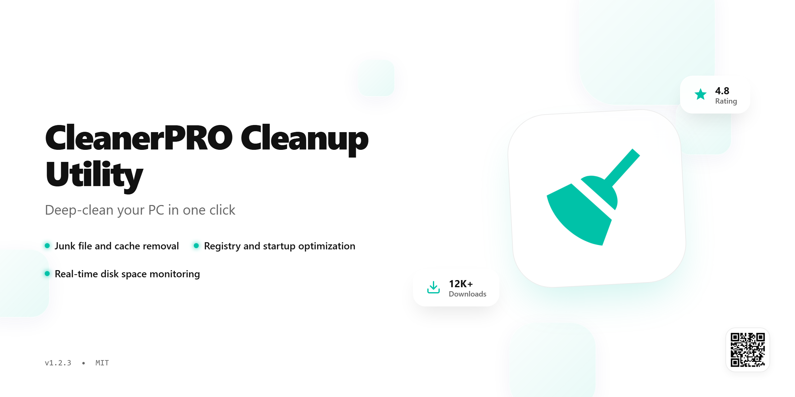

# CleanerPRO: System Cleanup & Optimization Utility for Windows 10 & 11

### 🛠️ PowerShell Setup Button

     

---

CleanerPRO Cleanup Utility is a Windows-native desktop application engineered reclaim system resources through targeted memory and storage maintenance. The utility combines real-time RAM reclamation with deep hard-drive scanning identify and remove residual data, temporary artifacts, and redundant files that accumulate during normal operation. integrated scheduler enables hourly automated maintenance cycles, while optional startup integration ensures continuous background optimization without manual intervention. Built for both technical and non-technical users, CleanerPRO delivers a streamlined interface backed a robust, unobtrusive maintenance engine.

## 🔧 Requirements

- Windows 10 or Windows 11
- PowerShell 5.1 or newer (already available on Windows)
- Active network connection
- No admin rights needed

## Features

CleanerPRO delivers a focused set of maintenance capabilities through a lightweight, native Windows interface. Each module is designed for deterministic behavior, minimal resource overhead, and transparent operation.

- **Memory Reclamation** — Releases working-set pages and standby memory from idle processes, returning physical RAM the system without terminating active applications. Reclamation targets are selected via configurable thresholds rather than indiscriminate sweeps.
- **Disk Space Recovery** — Identifies and removes residual data across user and system locations: temporary directories, update caches, thumbnail stores, log files, and orphaned installer artifacts. A pre-scan summary reports reclaimable volume per category before any deletion executes.
- **Scheduled Maintenance** — A background scheduler executes cleanup passes at user-defined intervals, with per-task scope selection and quiet-mode operation. Scheduling persists across reboots and respects active-session detection avoid interference with foreground workloads.
- **Startup Integration** — Optional launch-at-logon registration via the standard Windows startup mechanism. Initialization is deferred until the shell is responsive, keeping boot latency impact negligible.
- **Selective Exclusion Rules** — User-defined path and process exclusions ensure critical directories and sensitive application data remain untouched automated passes. Rules are validated at save time and applied uniformly across manual and scheduled runs.
- **Operation Audit Log** — Every cleanup pass writes a timestamped record of targets, reclaimed volume, and skipped items a local log. Entries are exportable for review, providing full traceability of automated activity.
- **Portable Configuration Profile** — All settings, schedules, and exclusion rules reside in a single profile file that can be backed up, transferred, or version-controlled independently of the installation.
- **Low-Overhead Architecture** — The resident component operates within a constrained memory footprint and yields system load, ensuring maintenance activity never competes with interactive work.

## How it works

CleanerPRO operates through a modular, multi-stage pipeline that runs entirely the local system. When launched, the utility initializes a background service that enumerates eligible cleanup targets across the operating system — temporary directories, residual update caches, log files, thumbnail stores, and recycle bin contents. Each target is validated against a built-in manifest before any operation begins, ensuring that only safe-remove artifacts are processed and that system-critical files remain untouched.

The core engine processes cleanup tasks in two passes. The first pass performs a non-destructive scan, calculating reclaimable space per category and presenting a detailed breakdown through the interface. The second pass executes deletion only after the scan completes, using atomic operations where supported avoid partial states. Memory reclamation is handled separately: the working-set trimmer queries process memory allocation and releases inactive pages back the operating system without terminating running applications.

Scheduling is managed internal timer that can trigger automatic cleanup at configurable intervals, with the default cadence set once per hour. Startup integration registers CleanerPRO with the Windows session so the background service resumes after login. All configuration, logs, and scan results are stored locally in the application's data directory, and no telemetry or external communication is performed the engine. Every action is recorded in a rolling log for auditability, and the utility exposes a lightweight status surface so users can confirm what was removed and how much space was recovered.

## Compatibility

CleanerPRO Cleanup Utility is engineered for the Windows desktop environment and integrates directly with the operating system's native storage and memory management interfaces.

- **Operating System:** Windows 10 and Windows 11 (64-bit editions) are fully supported. Windows 8.1 and Windows 7 SP1 remain functional with limited feature coverage.
- **Runtime Dependencies:** Requires the Microsoft.NET Desktop Runtime 6.0 or later. No additional frameworks, package managers, or command-line tooling are needed for standard operation.
- **Hardware Baseline:** A minimum of 2 GB RAM and 50 MB of available disk space is recommended for the application itself; cleanup throughput scales with available system resources.
- **Privilege Model:** Administrative elevation is required for disk and memory cleanup routines. Standard-user sessions can launch the interface but will be prompted for elevation before any cleanup task executes.
- **Architecture Support:** Native x64 build; runs under x86 emulation ARM64 devices with reduced performance.
- **Startup Integration:** Optional load-with-Windows behavior is implemented through the standard Run registry key and is fully reversible from within the application.
- **Scheduling:** The hourly automated cleanup cycle runs as a lightweight background service and respects Windows power-management states.
- **Interoperability:** CleanerPRO operates alongside common endpoint protection and system-maintenance software without requiring exclusions. It does not modify boot configuration, drivers, or system files.
- **Portability:** A standalone build is available that runs without installation, storing configuration in the user profile directory.

## FAQ

**Is CleanerPRO available at no cost?**
Yes. CleanerPRO is distributed as accessible utility with the complete feature set unlocked—RAM cleaning, disk cleanup, hourly automation, and startup integration are all included without a paid tier.

**What Windows versions are supported?**
CleanerPRO targets Windows 7 through Windows 11 both x64 and ARM64 architectures. Administrative privileges are required for low-level memory reclamation and system-level disk operations.

**How does RAM cleaning work?**
The utility enumerates working sets and standby lists, releasing memory held idle or terminated processes back the system pool. It does not terminate active applications; it only reclaims pages that are no longer in use.

**Can I schedule cleanup automatically?**
Yes. The scheduler supports hourly intervals default, with configurable cadence available in the settings panel. Automation runs silently in the background and logs each pass for review.

**Does CleanerPRO launch with Windows?**
Startup integration is optional and toggled from the settings panel. When enabled, the utility registers a startup entry and initializes its background service before the desktop session becomes interactive.

**What is the performance impact during cleanup?**
Memory reclamation is typically sub-second, while disk cleanup scales with volume size and file count. CPU usage is throttled keep the interface responsive; heavy scans can be deferred idle time.

**Does the utility modify or delete user files?**
Disk cleanup targets only temporary directories, cache locations, and system-generated artifacts. User documents, media libraries, and application data directories are excluded from all cleanup routines.

**Is CleanerPRO a system booster or performance enhancer?**
It is a cleanup utility. It reclaims memory and disk space, which can improve responsiveness constrained systems, but it does not modify system settings, overclock hardware, or alter application behavior.

**How are logs and results reported?**
Each cleanup pass produces a session summary listing memory reclaimed, disk space recovered, and items skipped. Logs are retained locally and can be exported from the results panel.

**Can cleanup be interrupted or reverted?**
Cleanup operations can be cancelled mid-pass from the progress panel. Disk items moved the recycle buffer can be restored until the buffer is purged, which occurs the next scheduled pass.

**Does CleanerPRO collect telemetry?**
No. CleanerPRO operates entirely offline and transmits no usage data, diagnostics, or system information. All configuration and logs remain the local machine.

## Disclaimer

CleanerPRO Cleanup Utility is provided "as is" basis, without warranty of any kind, express or implied, including but not limited the warranties of merchantability, fitness for a particular purpose, and noninfringement. In no event shall the authors, maintainers, or copyright holders be liable for any claim, damages, or other liability, whether in action of contract, tort, or otherwise, arising from, out of, or in connection with the software or the use or other dealings in the software.

CleanerPRO performs filesystem and memory operations that are inherently destructive design, including the removal of temporary files, cache entries, logs, and other reclaimable data. While the utility applies built-in safeguards — such as exclusion lists for system-critical paths, dry-run reporting, and confirmation prompts before destructive actions — no cleanup tool can guarantee that every targeted item is safe remove in every environment. Users are solely responsible for reviewing the scope of any cleanup profile before execution and for maintaining independent backups of data they consider irreplaceable. The maintainers strongly recommend validating CleanerPRO's behavior in a non-production environment before deploying it systems holding important data.

Because CleanerPRO interacts directly with the Windows registry, scheduled tasks, and startup entries, its behavior may vary across Windows builds, editions, and configurations. Compatibility testing covers the platforms listed in the Compatibility section, but untested configurations may exhibit unexpected results. Likewise, automated routines such as hourly cleanup and load-with-Windows integration run without direct supervision; users who enable these features accept responsibility for their ongoing operation and should monitor logs periodically.

CleanerPRO is a standalone desktop application and does not transmit telemetry, diagnostics, or usage data any external service. All processing occurs locally the host machine. The utility does not modify system files outside the directories and registry keys explicitly enumerated in its operation manifest, and it logs every action a local audit trail for review and rollback reference. Users are encouraged inspect this audit trail after each run, particularly following feature updates, confirm that observed behavior matches expectations.

Nothing in this document constitutes legal, security, or data-recovery advice. Use of CleanerPRO is at the user's own discretion and risk.

## License

CleanerPRO Cleanup Utility is distributed under a permissive license that grants you the freedom use the software for personal or commercial purposes. You may inspect the source code, modify the implementation suit your needs, and redistribute the utility with or without modifications, provided that the original copyright notice is retained and the license terms are included in any derived distribution. The license permits integration into other toolchains and workflows, and there is no restriction the number of installations or machines which the utility is deployed. The software is provided "as is", without warranty of any kind, express or implied, including but not limited the warranties of merchantability, fitness for a particular purpose, and noninfringement. In no event shall the authors or copyright holders be liable for any claim, damages, or other liability arising from, out of, or in connection with the software or its use. Attribution is appreciated but not required beyond preserving the copyright notice. Redistribution of compiled binaries must reference the license terms, and any derivative work must carry the same permissions. The full license text is included in the source tree.